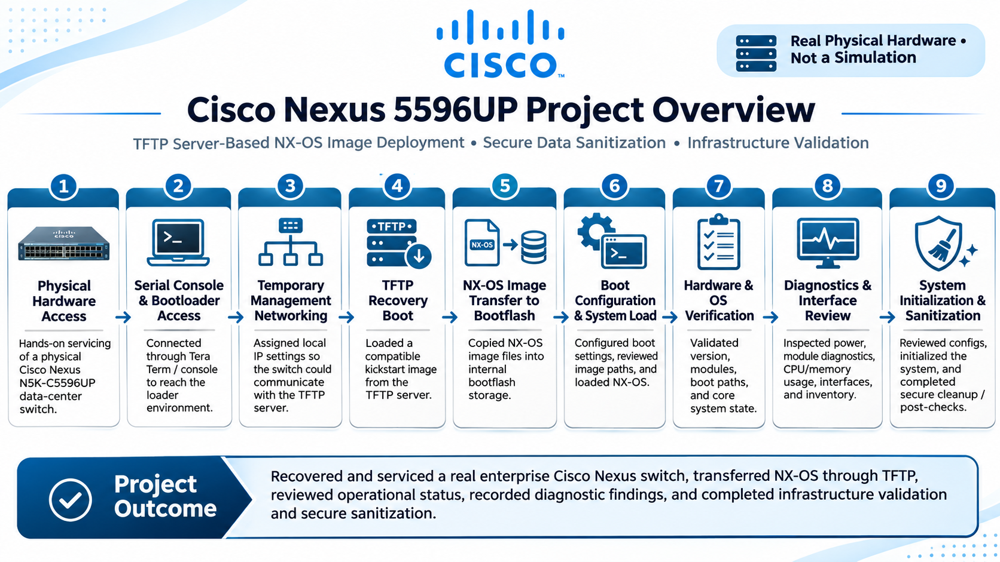

  

# Cisco Nexus 5596UP | TFTP Server-Based NX-OS Recovery, System Initialization & Hardware Diagnostics

**Physical Cisco Nexus N5K-C5596UP | Cisco NX-OS | TFTP Recovery | Bootflash | Hardware Diagnostics**

**[View Technical Project Report (PDF)](./Cisco_Nexus_5596UP_Technical_Project_Reviewed.pdf)**

## Table of Contents

1. [Project Overview](#project-overview)
2. [Hardware and Tools](#hardware-and-tools)
3. [Physical Equipment](#physical-equipment)
4. [Bootloader Access and TFTP Recovery](#bootloader-access-and-tftp-recovery)
5. [NX-OS Image Transfer and Boot Configuration](#nx-os-image-transfer-and-boot-configuration)
6. [NX-OS and Hardware Verification](#nx-os-and-hardware-verification)
7. [System and Interface Diagnostics](#system-and-interface-diagnostics)
8. [Configuration and System Initialization](#configuration-and-system-initialization)
9. [Project Results](#project-results)
10. [Technical Report](#technical-report)
11. [About](#about)

---

This repository documents operating-system recovery, hardware diagnostics, and system initialization performed on a physical Cisco Nexus N5K-C5596UP data-center switch.

Recovery operations were carried out through a serial-console connection using Tera Term and a locally configured TFTP server. The process included bootloader access, temporary network configuration, NX-OS kickstart loading, system-image transfer to internal bootflash, and boot-variable configuration.

Following recovery, the switch was inspected through the NX-OS CLI to review installed modules, operating-system versions, power-supply status, hardware diagnostics, CPU and memory utilization, Ethernet interfaces, and saved configurations.

The final maintenance stage involved system initialization and configuration-clearing operations. Terminal captures document the executed commands, observed system responses, and configuration or compatibility issues encountered during the procedure.

  

[↑ Back to Table of Contents](#table-of-contents)
---

## Recovery Workflow

```mermaid
flowchart TD
    A["Physical Cisco Nexus N5K-C5596UP"]
    B["Serial Console Access via Tera Term"]
    C["Access Cisco Bootloader"]
    D["Configure Temporary IP Settings"]
    E["Boot NX-OS Kickstart via TFTP"]
    F["Clear Startup Configuration and Reload"]
    G["Configure Management Interface mgmt0"]
    H["Transfer NX-OS System Image via TFTP"]
    I["Copy Image to Internal Bootflash"]
    J["Verify NX-OS Image Files"]
    K["Configure Kickstart and System Boot Variables"]
    L["Inspect Boot Paths and Compatibility Warnings"]
    M["Load NX-OS System Image"]
    N["Verify NX-OS Version and Hardware Modules"]
    O["Inspect Power Supplies and Diagnostics"]
    P["Review CPU, Memory and Interfaces"]
    Q["Inspect Running and Startup Configurations"]
    R["Review MAC Address Table and Spanning Tree"]
    S["Execute System Initialization"]
    T["Clear Boot Variables and Saved Configurations"]
    U["Inspect Final Storage and Bootloader State"]
    V["Document Results and Technical Findings"]

    A --> B
    B --> C
    C --> D
    D --> E
    E --> F
    F --> G
    G --> H
    H --> I
    I --> J
    J --> K
    K --> L
    L --> M
    M --> N
    N --> O
    O --> P
    P --> Q
    Q --> R
    R --> S
    S --> T
    T --> U
    U --> V

    classDef hardware fill:#073B70,color:#ffffff,stroke:#007CC3,stroke-width:2px
    classDef recovery fill:#E8F4FD,color:#082D50,stroke:#007CC3,stroke-width:1px
    classDef verification fill:#E8F5F1,color:#115846,stroke:#259B78,stroke-width:1px
    classDef sanitization fill:#FFF3E2,color:#754600,stroke:#D89632,stroke-width:1px
    classDef complete fill:#073B70,color:#ffffff,stroke:#259B78,stroke-width:2px

    class A hardware
    class B,C,D,E,F,G,H,I,J,K,L,M recovery
    class N,O,P,Q,R verification
    class S,T,U sanitization
    class V complete
```

[↑ Back to Table of Contents](#table-of-contents)

---

## 2. Hardware and Tools

| Component | Purpose |
|---|---|
| Cisco Nexus **N5K-C5596UP** | Physical enterprise data-center switch |
| **Tera Term** and serial-console cable | Direct access to bootloader and NX-OS CLI |
| **TFTP server** | Network-based delivery of recovery images |
| Cisco **NX-OS kickstart and system images** | Boot and restore the operating system |
| Internal **bootflash** | Store operating-system image files |
| Built-in NX-OS diagnostics | Inspect modules, power, interfaces, and system resources |

The switch and TFTP server communicated on the same local subnet; a default gateway was not needed for the transfer.

[↑ Back to Table of Contents](#table-of-contents)

---

## 3. Physical Equipment

**Nexus 5596UP — chassis and front interfaces**

**Internal chassis — hardware layout**

**Internal circuit board — close-up**

These photographs show the actual chassis and internal components associated with the project.

[↑ Back to Table of Contents](#table-of-contents)

---

## 4. Bootloader Access and TFTP Recovery

The switch was accessed through its serial console. From the `loader>` environment, I checked its network settings and assigned a temporary management IP address so it could communicate directly with the TFTP server.

**Key commands:** `show ip`, `set ip`, and `boot tftp://...`.

- `show ip` displays the bootloader's network settings.
- `set ip` supplies the switch with an address and subnet mask for the recovery connection.

- `boot tftp://...` retrieves the specified NX-OS kickstart image from the TFTP server and initiates the boot sequence.

**Terminal evidence**

Next, `write erase` cleared the saved startup configuration and `reload` restarted the switch during the recovery workflow.

[↑ Back to Table of Contents](#table-of-contents)

---

## 5. NX-OS Image Transfer and Boot Configuration

After kickstart loaded, I configured the management interface and copied the NX-OS system image from the TFTP server into **bootflash**, the switch's local image storage.

**Key commands:** `interface mgmt0` / `interface m0`, `ip address`, `no shutdown`, `copy tftp: bootflash:`, and `dir bootflash:`.

- The management-interface commands establish connectivity to the TFTP server.
- `copy tftp: bootflash:` saves the network-hosted image locally.
- `dir bootflash:` confirms the image files are present.

**Image transfer to bootflash**

**Bootflash inspection immediately after the transfer**

**Boot-variable configuration and verification**

The `boot system bootflash:...` command selects the NX-OS system image for startup. `copy run start` saves the active settings, while `show boot` displays the configured kickstart and system paths.

### Boot Configuration Findings

Following the TFTP image transfer, the NX-OS system image was stored in internal bootflash and referenced using the `boot system` configuration command.

During boot-variable configuration, the switch reported an image compatibility-check failure (`0x80450002`). The console also recommended using `install all` for software upgrades and downgrades.

The running configuration was saved using `copy run start`; however, a successful configuration save does not confirm compatibility between the configured kickstart and system images.

The captured directory listings and boot-variable output also show differences between locally listed image releases and the configured startup paths.

These findings are retained as part of the maintenance record. The published evidence establishes the configuration attempts and observed system responses, but does not independently verify a subsequent successful reboot using the selected image combination.

**Review local images and load the system image**

`dir bootflash:` checks the stored image filenames. `load bootflash:...` starts the selected NX-OS system image from local storage.

[↑ Back to Table of Contents](#table-of-contents)

---

## 6. NX-OS and Hardware Verification

The switch reached the NX-OS command-line interface, allowing inspection of the running operating-system version, chassis identification, installed hardware modules, and configured boot variables.

`show version` identified the running NX-OS release, while `show module` provided hardware-module identification and operational status. The `show boot` output was reviewed to determine the configured kickstart and system image paths.

These commands establish the observed operating state during the maintenance session.

**Key commands:** `terminal length 0`, `show version`, `show module`, and `show boot`.

- `terminal length 0` displays longer command results without paging.
- `show version` identifies the NX-OS release and chassis.
- `show module` lists installed hardware modules and their status.
- `show boot` shows the image paths configured for startup.

[↑ Back to Table of Contents](#table-of-contents)

---

## 7. System and Interface Diagnostics

I ran diagnostic commands to inspect hardware condition, operating-system resources, and Ethernet interfaces.

**Power and module diagnostics**

- `show environment power` identified Power Supply 1 as operational (`ok`) and Power Supply 2 as `fail/shutdown`. The switch remained operational during inspection but did not have functional power-supply redundancy.
- `show diagnostic result module all` displayed the built-in hardware diagnostic results, including a reported `PASS` for the supervisor module.
- 
**Hardware Finding:** One power supply reported a failure/shutdown condition. The issue was documented through NX-OS environmental diagnostics;

**Operating-system resources**

`show system resources` reports CPU and memory usage. `show processes cpu` provides a more detailed view of running processes. An initial `show process cpu` attempt was rejected, and the command was corrected.

**Ethernet interface checks**

`show interface` was used to inspect Ethernet port state, interface counters, operating characteristics, and reported errors.

`show interface brief` provided a summary of interface conditions across the switch, including disconnected ports and interfaces without installed transceivers.

These commands document the interface states reported by NX-OS during inspection. Physical connectivity, end-to-end traffic forwarding, and transceiver functionality were not independently verified.

**Inventory and management state**

`show inventory` / `show inv` identifies the installed chassis and components. Interface output also shows management addressing and link status.

[↑ Back to Table of Contents](#table-of-contents)

---

## 8. Configuration and System Initialization

Before initialization, I inspected active and saved configurations along with the switch's Layer 2 state.

**Key commands:** `show running-config`, `show startup-config`, `show mac address-table`, `show spanning-tree summary`, and `show diagnostic bootup level`.

- The running and startup configuration commands show current settings and what is saved for reboot.
- The MAC address table shows learned Layer 2 addresses when present.
- Spanning Tree output shows loop-prevention settings.
- Startup diagnostics show the configured boot-time test level.

A MAC-table command initially returned a syntax error; the corrected form was used in the terminal session.

**System initialization**

Executed `init system` from the NX-OS boot environment and confirmed the initialization operation.

The command initiated removal of stored configuration, license data, and bootflash contents. The captured console output documents filesystem preparation, storage formatting, and completion of the initialization sequence.

The initialization result establishes that the reported operation completed.

**Final boot settings and storage review**

`write erase boot` was executed to clear stored boot-variable configuration. Additional cleanup operations included `write erase debug` and `write erase` to target saved diagnostic and startup-configuration data.

The console output records the accepted erase commands and an unsupported `clear nvram` attempt.

Post-initialization inspection included `show ip` and `dir bootflash:` to examine the remaining management settings and local storage contents. The published directory listing showed only the `lost+found` directory.

The final captures document the observed configuration and storage state following initialization.

[↑ Back to Table of Contents](#table-of-contents)

---

This maintenance record documents NX-OS recovery, image management, boot configuration, hardware inspection, and system initialization performed on a Cisco Nexus N5K-C5596UP data-center switch.

### Recorded Technical Results

| Technical Area | Recorded Finding |
|---|---|
| Serial Console Access | Established console access through Tera Term. |
| Bootloader Recovery | Accessed the Cisco loader environment and initiated kickstart recovery over TFTP. |
| Network Configuration | Configured temporary management connectivity for image transfer. |
| NX-OS Image Transfer | Transferred the operating-system image from the TFTP server to internal bootflash. |
| Bootflash Management | Inspected local image files and configured startup-image references. |
| Boot Configuration | Recorded an image compatibility-check failure during boot-variable configuration. |
| Operating System | Reached the NX-OS CLI and inspected the running software release. |
| Hardware Inventory | Identified the chassis and installed modules. |
| Power Subsystem | One power supply operational; second supply reported `fail/shutdown`. |
| Module Diagnostics | Supervisor diagnostic output reported `PASS`. |
| System Resources | Inspected CPU usage, memory utilization, and process activity. |
| Network Interfaces | Reviewed interface state, counters, and transceiver presence. |
| Layer 2 Inspection | Inspected MAC address table and spanning-tree information. |
| Configuration Inspection | Reviewed running and startup configurations. |
| System Initialization | Executed initialization and examined the resulting storage state. |
| Configuration Clearing | Executed boot-variable, diagnostic, and startup-configuration erase commands. |

### Technical Findings

**NX-OS Image Compatibility**

A compatibility-check failure occurred during boot configuration. 

**Power-Supply Condition**

Environmental diagnostics identified a failure/shutdown condition affecting one power supply. The switch remained operational during inspection without functional redundant power.

**Post-Initialization Storage**

The initialization procedure completed, and the subsequent bootflash inspection showed the remaining filesystem structure. Restoration of the operating-system images   was tested and fully boots.

### Verification Scope

The recorded console output supports the recovery operations, image transfers, configuration commands, diagnostic inspections, and initialization activities described in this report.

The switch succesffully boots with the new OS ans is ready for configurations.

[↑ Back to Table of Contents](#table-of-contents)

## 11. About

I'm Brandon Stevenson, an IT Infrastructure Technician working with enterprise server and network equipment.

My experience includes physical infrastructure servicing, Cisco networking equipment, server management interfaces, operating-system imaging, hardware troubleshooting, and technical documentation.

This repository documents one of my hands-on infrastructure projects using physical enterprise networking hardware.

My technical projects reflect this combination of hands-on enterprise hardware experience, IT administration, programming, and infrastructure automation.

**Portfolio:** [brandons-resume.com](https://brandons-resume.com)  
**GitHub:** [Programmer-stevenson](https://github.com/brandon-in-tech)  
**LinkedIn:** [Brandon Stevenson](https://www.linkedin.com/in/brandon-in-tech/)

[↑ Back to Table of Contents](#table-of-contents)
